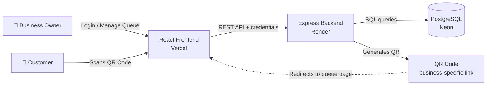

<h1 align="center">📲 ScanQ</h1>
<h3 align="center">Skip the Line. Not Your Turn.</h3>
<p align="center"><i>A QR-Powered Virtual Waiting Line</i></p>


ScanQ transforms traditional physical queues into digital waiting experiences. Customers scan a QR code, join a queue from their smartphones, and track their turns without standing in line. Businesses can manage walk-in customers through a centralized dashboard.

🔗 **Live Demo:** [scan-queue-red.vercel.app](https://scan-queue-red.vercel.app/)

---

## 🎯 The Problem

Long waiting lines are a daily frustration at clinics, hospitals, salons, restaurants, banks and government offices.

- **Patients and customers** stand for hours with no idea when their turn will come, and are afraid to step away in case they miss it.
- **Sick patients, elderly people and parents with children** are forced to wait in crowded spaces.
- **Businesses** struggle to manage walk-in crowds and keep track of who is next.

## ✅ The Solution

ScanQ replaces the physical line with a **virtual queue**:

1. The business displays its unique QR code at the premises.
2. The customer scans it and joins the queue in seconds, with no app install or account needed.
3. The customer sees their **token number, position, people ahead and estimated waiting time** live, and can leave the queue anytime.
4. The business calls the next customer from a dashboard.

Customers can wait wherever they are comfortable and know exactly where they stand. Businesses get an organised, trackable queue.

---

## ✨ Key Features

### 🏢 Business Dashboard
- Business registration and login
- Secure authentication using **JWT** and **HTTP-only cookies**
- Business profile management
- Dashboard to view current queue entries and their statuses
- Call the next customer
- Update customer queue status

### 👤 Customer Experience (QR-based)
- Unique QR code generated for each business
- Scan to open the business's queue page
- Join the queue with name, mobile number, party size and an optional description
- Track queue position and the number of people ahead
- View estimated waiting time
- Leave the queue when no longer waiting

### 🔢 Queue Management
- Unique token number for every queue entry
- Statuses: `WAITING` · `CALLED` · `SERVED` · `CANCELLED`
- Multi-business support with business-specific queues

---

## 🛠️ Tech Stack

| Layer | Technologies |
|---|---|
| **Frontend** | React.js, Vite, Tailwind CSS, React Router DOM, Lucide React, Fetch API |
| **Backend** | Node.js, Express.js, JWT, bcrypt, cookie-parser, `qrcode` |
| **Database** | PostgreSQL (Neon) |
| **Deployment** | Vercel (frontend), Render (backend), Neon (database) |
| **Tools** | Git, GitHub |

---

## 🏗️ Application Architecture



- The React frontend serves both the business dashboard and the customer-facing queue page.
- The Express backend exposes REST APIs for authentication, queue management, QR code generation and customer operations.
- PostgreSQL stores business information and queue entries.
- QR codes link to business-specific frontend routes.

---

## 📁 Project Structure

> Monorepo containing the frontend and backend.

```
ScanQ/
├── frontend/        # React + Vite + Tailwind client
│   ├── src/
│   └── package.json
├── backend/         # Node.js + Express REST API
│   ├── src/
│   └── package.json
└── README.md
```

---

## ⚙️ Installation and Local Setup

### Prerequisites
- Node.js (v18 or later)
- npm
- A PostgreSQL database (local, or a free [Neon](https://neon.tech) project)

### 1. Clone the repository
```bash
git clone https://github.com/Arpit11-svg/scan-queue.git
cd scan-queue
```

### 2. Set up the backend
```bash
cd backend
npm install
cp .env.example .env   # then fill in your values
npm run dev            # or: npm start
```

### 3. Set up the frontend
```bash
cd frontend
npm install
cp .env.example .env   # then fill in your values
npm run dev
```

The frontend runs on `http://localhost:5173` by default (Vite).

---

## 🔐 Environment Variables

Use placeholder values only. Never commit real secrets.

**`backend/.env`**
```env
PORT=5000
DATABASE_URL=postgresql://<user>:<password>@<host>/<database>?sslmode=require
JWT_SECRET=<your_jwt_secret>
FRONTEND_URL=http://localhost:5173
```

**`frontend/.env`**
```env
VITE_API_URL=http://localhost:5000
```

---

## 🚀 Live Demo

| Service | URL |
|---|---|
| Frontend | https://scan-queue-red.vercel.app/ |
| Backend API | https://scanq-backend.onrender.com/ |
| Health Check | https://scanq-backend.onrender.com/health |

> ⏳ The backend is hosted on Render's free tier and may take ~30–60 seconds to wake up after inactivity.

---

## 🔮 Future Improvements

These are planned ideas and are **not yet implemented**:

- SMS / WhatsApp notifications when a customer's turn is near
- Analytics dashboard (average wait time, peak hours, daily footfall)
- Dynamic waiting-time estimation based on historical service times
- Multiple counters or service points per business
- Automated tests and CI/CD pipeline

---

## 👨‍💻 Author

**Arpit Choudhary**

---

⭐ If you found this project useful, consider giving it a star!
